# CardioPredict AI: End-to-End Heart Disease Risk Prediction & Clinical Decision Support System

[](https://www.python.org/downloads/)
[](https://flask.palletsprojects.com/)
[](https://scikit-learn.org/)
[](https://opensource.org/licenses/MIT)
[]()

> **AI Pioneers Internship — Week 4 Final AI Capstone Project**  
> **Author:** Aafiya Kulsum  
> **Platform:** Yuva Intern

---

## 📌 Project Overview

**CardioPredict AI** is a production-grade, end-to-end Machine Learning web application and RESTful microservice engineered to assess coronary heart disease risk from patient clinical biomarkers. 

Built on the gold-standard UCI Cleveland dataset, the system implements data preprocessing, feature standardization, multi-algorithm benchmarking across 5 classifiers, 5-Fold Stratified Cross-Validation, GridSearchCV hyperparameter tuning, model serialization using **Joblib** and **Pickle**, and real-time inference via a responsive **Flask** web dashboard and OpenAPI JSON endpoints.

---

## 🏆 Key Performance Metrics (Holdout Test Set)

| Metric | Score | Clinical Significance |
| :--- | :---: | :--- |
| **Sensitivity / Recall** | **93.94%** | Critical: Minimizes false negatives (missed cardiac disease) |
| **ROC-AUC Score** | **90.80%** | Exceptional discriminative capability across decision thresholds |
| **Overall Accuracy** | **81.97%** | High baseline generalization on unseen patient data |
| **Precision** | **77.50%** | Reliable positive predictive value |
| **F1-Score** | **84.93%** | Harmonic balance between sensitivity and precision |

---

## 🏗️ System Architecture

```mermaid
flowchart LR
    A["Raw Clinical Data<br>(UCI Cleveland 303 rows)"] --> B["Data Preprocessing<br>& StandardScaler"]
    B --> C["Stratified 80/20 Partition<br>(Train: 241, Test: 61)"]
    C --> D["Multi-Model Benchmarking<br>(LR, RF, SVM, GB, KNN)"]
    D --> E["GridSearchCV Tuning<br>(Optimal Random Forest)"]
    E --> F["Model Serialization<br>(Joblib & Pickle)"]
    F --> G["Flask REST API & Web UI<br>(/api/predict & /)"]
    G --> H["Clinical Assessment &<br>Personalized Guidance"]
```



---

## 🔬 Algorithm Benchmark Summary

Under 5-Fold Stratified Cross-Validation on the training partition:

| Classifier | CV F1 Score (Mean ± Std) | Test Accuracy | Test Recall | Test ROC-AUC |
| :--- | :---: | :---: | :---: | :---: |
| **Random Forest (Tuned)** | **0.8673 ± 0.032** | **81.97%** | **93.94%** | **0.9080** |
| Support Vector Machine (SVC) | 0.8252 ± 0.045 | 83.61% | 93.94% | 0.8810 |
| Gradient Boosting | 0.7841 ± 0.074 | 81.97% | 87.88% | 0.8690 |
| K-Nearest Neighbors | 0.8188 ± 0.039 | 80.33% | 90.91% | 0.8674 |
| Logistic Regression | 0.8379 ± 0.051 | 78.69% | 87.88% | 0.8647 |

---

## 📂 Project Structure

```text
├── data/
│   └── heart.csv                       # UCI Cleveland Heart Disease dataset
├── models/
│   ├── heart_disease_model.joblib      # Production serialized model (Joblib)
│   ├── heart_disease_model.pkl         # Serialized model (Pickle)
│   ├── scaler.joblib                   # Serialized StandardScaler
│   └── model_metadata.json             # Model hyperparameters, version & metrics
├── src/
│   ├── __init__.py
│   ├── data_preprocessing.py           # Ingestion, validation, cleaning, scaling
│   └── model_training.py               # Training, benchmarking, tuning, export
├── app/
│   ├── __init__.py
│   ├── app.py                          # Flask application & REST API microservice
│   ├── templates/
│   │   ├── index.html                  # Interactive assessment dashboard
│   │   └── result.html                 # Printable diagnostic report & recommendations
│   └── static/
│       ├── css/style.css               # Clean healthcare aesthetic styling
│       ├── js/script.js                # Instant AJAX calculations & sample filler
│       └── plots/                      # Generated evaluation charts
├── tests/
│   ├── test_preprocessing.py           # Preprocessing & schema validation tests
│   ├── test_model.py                   # Serialization parity & inference bounds tests
│   └── test_api.py                     # Flask HTTP endpoint & response tests
├── reports/
│   ├── plots/                          # Diagnostic charts (ROC, CM, Comparison, FI)
│   ├── Aafiya_Kulsum_Week4_AI_Capstone_Report.docx         # Formal Word Project Report
│   └── Aafiya_Kulsum_Week4_AI_Capstone_Presentation.pptx   # 16:9 Presentation Slides
├── submission/
│   └── PORTAL_SUBMISSION_DETAILS.txt   # Exact text & links for Yuva Intern portal
├── requirements.txt                    # Project dependencies
├── run.py                              # Server launcher (python run.py)
├── train.py                            # Pipeline retrain trigger (python train.py)
├── test_suite.py                       # Automated test suite (python test_suite.py)
└── README.md                           # Documentation & quickstart guide
```

---

## 🚀 Quickstart & Setup Guide

### 1. Clone the Repository
```bash
git clone https://github.com/alficodes/Cardio-Predict-AI.git
cd Cardio-Predict-AI
```

### 2. Create and Activate Virtual Environment
```bash
python -m venv venv
# On Windows:
venv\Scripts\activate
# On Linux / macOS:
source venv/bin/activate
```

### 3. Install Dependencies
```bash
pip install -r requirements.txt
```

### 4. Run the Web Application
```bash
python run.py
```
Open your browser and navigate to: **`http://127.0.0.1:5000`**

### 5. Retrain the Machine Learning Pipeline (Optional)
```bash
python train.py
```

### 6. Run the Automated Test Suite
```bash
python test_suite.py
```
*(Runs 11 test cases across data processing, model inference, and API endpoints)*

---

## 📡 RESTful API Reference

### Health Probe
- **Endpoint:** `GET /health`
- **Response:**
  ```json
  {
    "status": "healthy",
    "service": "CardioPredict AI Prediction Engine",
    "model_loaded": true,
    "scaler_loaded": true
  }
  ```

### Model Specifications
- **Endpoint:** `GET /api/models/info`
- **Response:** Returns model architecture, version, features, and evaluation metrics.

### Prediction Endpoint
- **Endpoint:** `POST /api/predict`
- **Headers:** `Content-Type: application/json`
- **Sample Request:**
  ```json
  {
    "age": 55,
    "sex": 1,
    "cp": 2,
    "trestbps": 130,
    "chol": 230,
    "fbs": 0,
    "restecg": 1,
    "thalach": 150,
    "exang": 0,
    "oldpeak": 1.0,
    "slope": 2,
    "ca": 0,
    "thal": 2
  }
  ```
- **Sample Response:**
  ```json
  {
    "status": "success",
    "prediction": 1,
    "diagnosis": "Heart Disease Indicated",
    "probability": 78.42,
    "risk_level": "High Risk",
    "timestamp": "2026-11-14T...",
    "recommendations": [
      {
        "title": "Immediate Cardiology Consultation",
        "description": "Elevated coronary risk detected. Comprehensive clinical evaluation advised."
      }
    ]
  }
  ```

---

## 🔒 Model Serialization: Joblib vs. Pickle

This project demonstrates and compares both serialization protocols:
- **Joblib (`models/heart_disease_model.joblib`):** Chosen for production deployment due to memory-mapped IO optimizations on Scikit-Learn tree ensembles.
- **Pickle (`models/heart_disease_model.pkl`):** Serialized for native Python standard library compliance. Both artifacts yield identical floating-point prediction probabilities.

---

## 📜 Deliverables for Internship Submission

- **Report Document:** [`reports/Aafiya_Kulsum_Week4_AI_Capstone_Report.docx`](reports/Aafiya_Kulsum_Week4_AI_Capstone_Report.docx)
- **Presentation Deck:** [`reports/Aafiya_Kulsum_Week4_AI_Capstone_Presentation.pptx`](reports/Aafiya_Kulsum_Week4_AI_Capstone_Presentation.pptx)
- **Portal Description Text:** [`submission/PORTAL_SUBMISSION_DETAILS.txt`](submission/PORTAL_SUBMISSION_DETAILS.txt)

---

## 👩‍💻 Author

**Aafiya Kulsum**  
*AI Pioneers Internship (Yuva Intern) — Week 4 Capstone*
